# Changelog

What changed in each release of AnythingToAnki, newest first.

## 1.7.2 — 2026-10-29

The System theme works in the macOS app.

### No longer broken
- **Theme: System** in the macOS app now follows macOS. Before, the app window stayed in whichever theme it was in when you chose **System**, and switching macOS between light and dark did nothing to it. The window's own controls change with the theme too, and the app opens in the right one.

## 1.7.1 — 2026-10-29

The macOS app opens the way you left it.

### No longer broken
- The macOS app window opens at the size and place you left it. Before, it came back at its default size in the middle of the screen every time you quit and opened the app again.

## 1.7.0 — 2026-10-29

Pick what a card teaches: any words of its phrase can become its target.

### Change target
**Edit → Change target** makes every word of the phrase clickable. Click the words you want to learn instead: one word, a few in a row, or words apart like `gave` and `up` in "gave it up". Press **Change target** (`Enter`) and the card is made anew for them, with a new meaning, speech and cloze, in the old card's place in the list. Words you wrote in with **Edit text** or that **Polish** brought in can be picked too. The old card is gone for good: **Rebuild** doesn't bring it back, and its word moves on to its next best phrase.
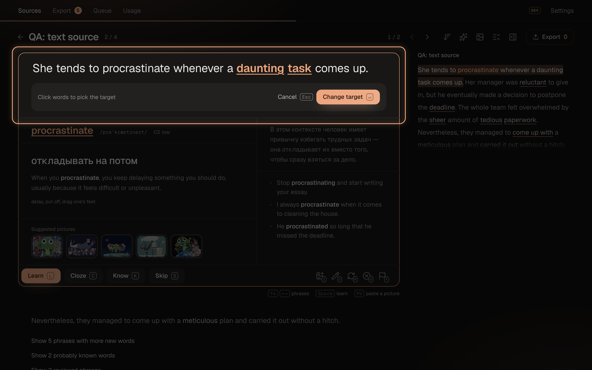

### No longer broken
- **Edit → Change boundary** opens the source text if it was hidden or sat below the phrase list in a narrow window. Before, it asked you to select in a panel you couldn't see.
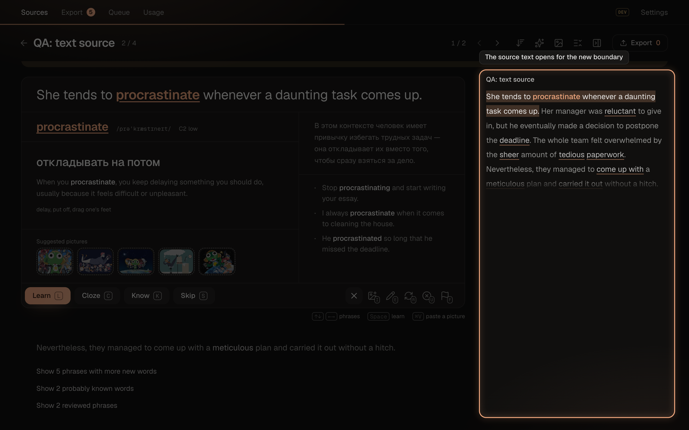
- Selecting text in the source text always opens **Add word**, even when the selection ends outside the text column, on a line break, between paragraphs or on a list marker.
- In the cloze editor, punctuation stays next to its word instead of standing apart.

## 1.6.3 — 2026-10-29

Export tells you where cloze cards go.

### No longer broken
- In Export, the panel on the right shows the **cloze note type** when the export has cloze cards. Before, it showed only the note type of regular cards.
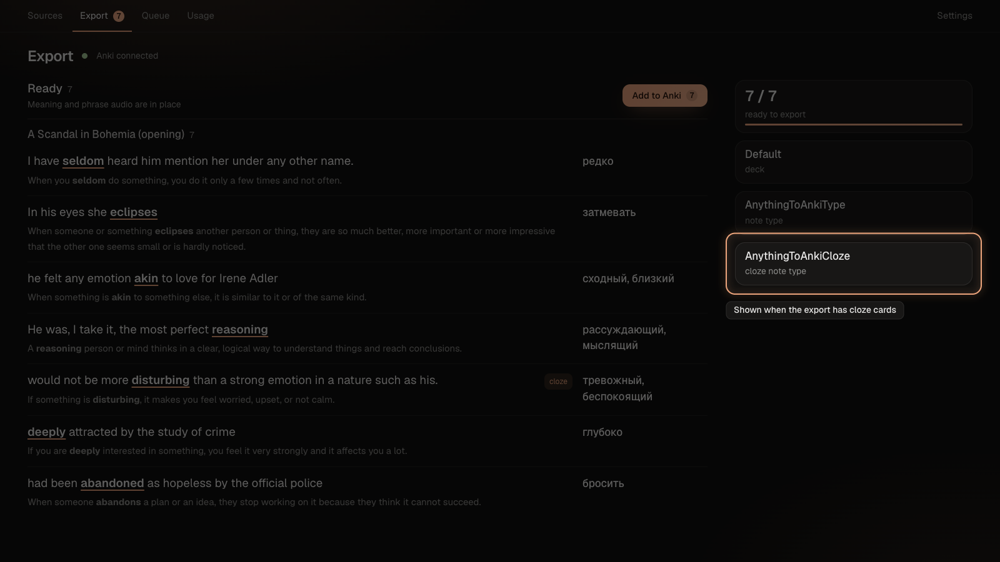
- Deck and note type names in that panel stay on one line instead of breaking in the middle of a word. A name too long for the panel ends with "…", and hovering over it shows it in full.

## 1.6.2 — 2026-10-29

Review keeps its toolbar in reach, and small screens stop cutting labels apart.

### Improvements
- In Review, the header with the phrase counter, the arrows, **Sort**, **✨**, the view toggles and **Export** now stays at the top while you scroll through the list. The source text on the right stays right under it.
- Keyboard hints under the card show each key as a key cap, and the toast after a decision says what happened: *Marked sigh to learn*, *Skipped sigh*.
- The Add source form shows the file format as a tag next to what it found in the file.

### No longer broken
- On a 320px phone the **Learn**, **Cloze**, **Know** and **Skip** buttons fit in one row.
- Menus no longer wrap their items: on a phone a submenu opens in place of the menu with a way back.
- In Export, button counts are badges, each missing part of a card is its own item, and deck and note type names no longer break across lines.

## 1.6.1 — 2026-10-29

Calibration remembers the words you skip, and generation can start with the cards at the top of the list.

### Skipped words stay skipped
Calibration now remembers the words it showed you and you didn't tap, and doesn't ask about them again. A new session goes on where the last one ended instead of starting with the same words. Skipped words are not marked as known or unknown: Review still suggests them. **Settings → Words → Skipped in calibration** shows how many there are, and **Ask skipped words again** lets calibration ask about them once more. **Rebuild list** keeps them.
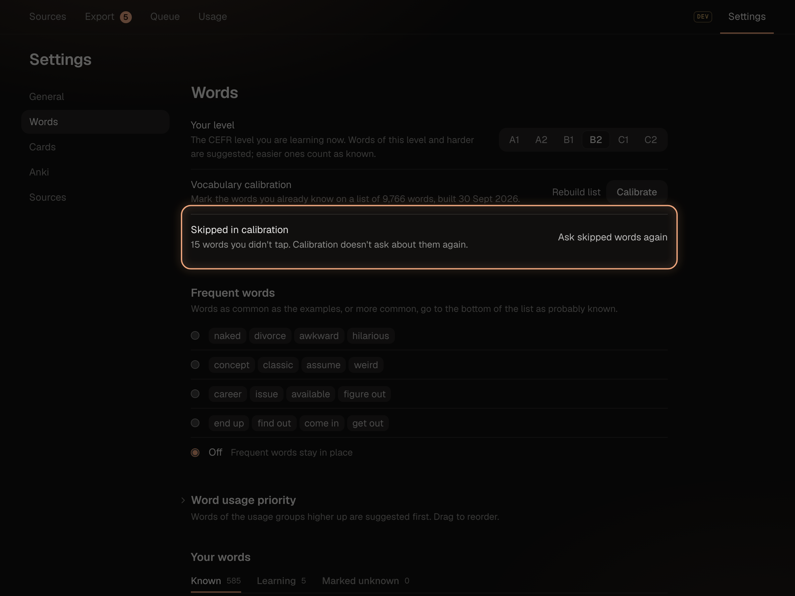

### Generate the next cards
Every item of the **✨** menu in Review has **Ready: generate next 100** and **All: generate next 100**. They fill in the first cards that don't have it yet, from the top of the list in its current order, so you can try generation on a big source without spending your Claude plan on all of it. **Settings → Cards → Generate next** sets how many cards it takes.
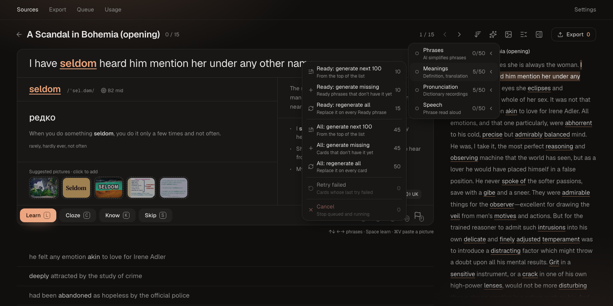

## 1.5.1 — 2026-10-29

Frequent words are easier to choose.

### No longer broken
- **Settings → Words → Frequent words** showed each option as a number and a line of words cut off by the edge of the dropdown. The options are now a list: each one shows its example words in full, so you can compare them at a glance. The confirmation asks with the same words.
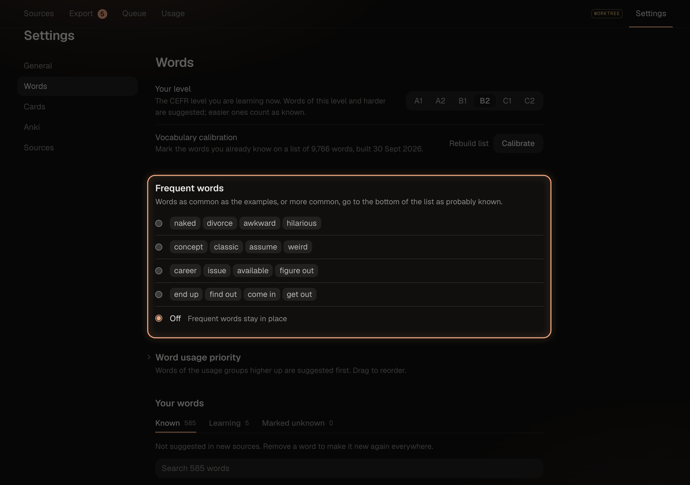
- In **Settings → Anki**, fields missing from a note type are now shown one by one instead of in a single line.

## 1.5.0 — 2026-10-29

Calibration asks about the words you will actually meet.

### Calibration like Review
Calibration used to pick one random word for each level and frequency, so most rounds were rare words you seldom meet. Now it shows the words Review would suggest to you, in the same order: common words first, words of your level before harder ones. Every word you tap is one card less in your sources. Word forms such as *playing* or *known* are left out, since Review only suggests *play* and *know*. The old way is still there: switch to **Mixed** at the top of the calibration screen.
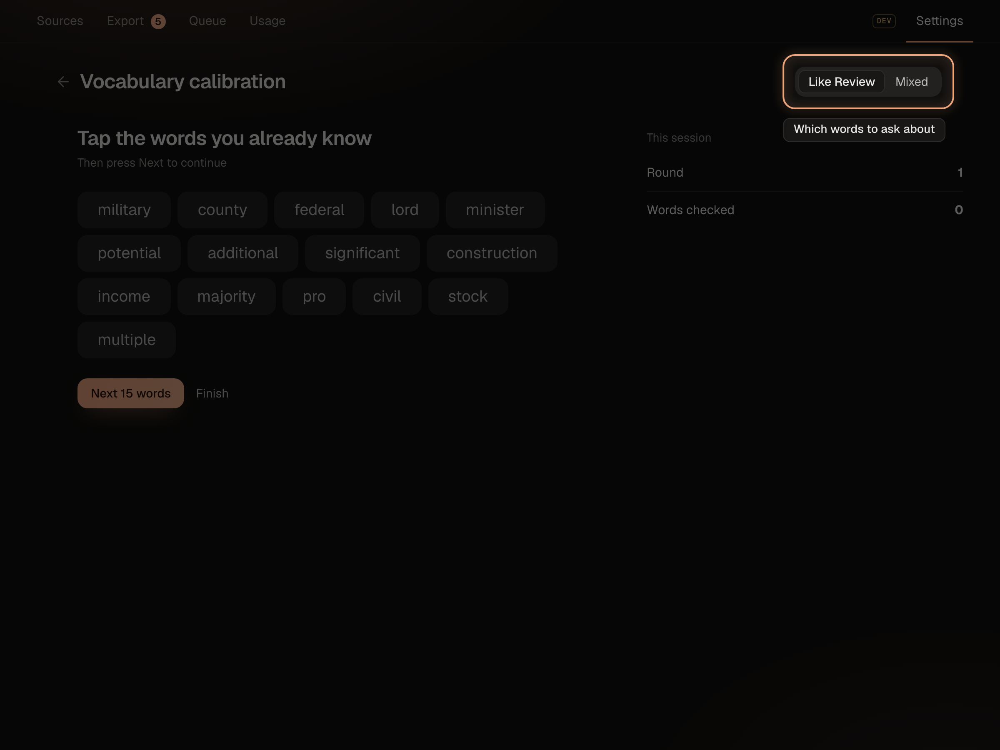

### No longer broken
- Calibration no longer asks about dictionary entries that are not words, such as *10th*, *mp3* or *expect'*.

## 1.4.0 — 2026-10-29

Settings are rebuilt around what you change in them.

### Settings you can find
Settings now have five sections: **General**, **Words**, **Cards**, **Anki** and **Sources**. **Words** holds everything about which words the app suggests, from your level to the words you already know. **Cards** holds everything about the card: how it looks on the review screen, and the AI model, voices and pictures it is made with. Settings you rarely touch, such as Anki field names and word usage priority, are folded away until you open them.
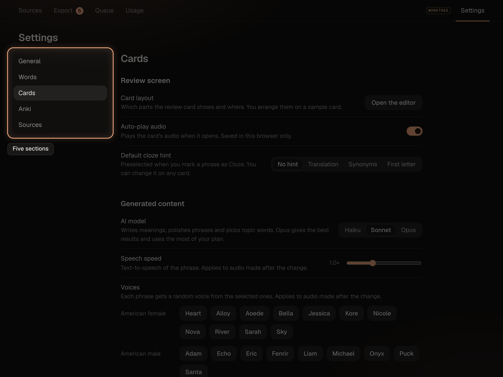

### Your words as a table
**Settings → Words → Your words** shows your **Known**, **Learning** and **Marked unknown** words as tables, newest first, with the day each word became known. The search looks through all of your words, not only the ones on screen, and the list shows 50 at a time.
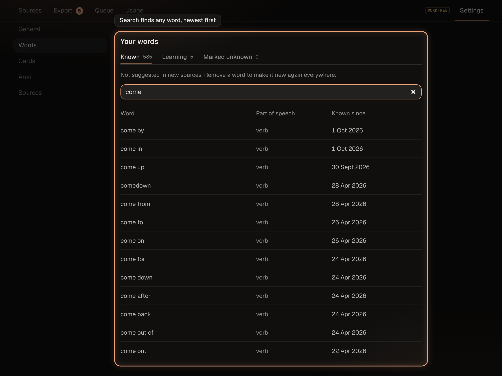

### New
- Settings save on their own, without a **Save** button. **Saved** shows next to the section title for a moment; text is saved when you leave the field.
- Changing **Your level** or **Frequent words** asks first, because it analyses every source again.
- Each Anki note type shows right next to its name whether it is ready in Anki, with the button that fixes it if not.

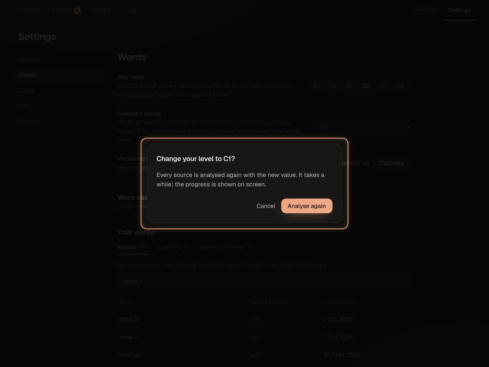

### Improvements
- Names match the rest of the app: Anki fields are named like the parts of the card, **Pictures per site**, **Vocabulary calibration** starts with **Build word list**, **Naming rule** for sources made by one add.
- **Speech speed** and **Voices** say they apply only to audio made after the change. **Theme** and **Auto-play audio** say they are saved in this browser only.
- Errors in Settings read as a sentence instead of raw server text.

### No longer broken
- The selected section in the settings list has its rounded corners and padding again.
- **Marked unknown** points to the right button on the card: **Mark words you don't know** (`U`).

## 1.3.2 — 2026-10-29

The Auto option for frequent words is gone.

### Improvements
- **Settings → Vocabulary → Frequent words** no longer has **Auto**. Auto could jump a whole step after a few **Learn** presses and suddenly move hundreds of cards in or out of **Ready**. If you had Auto, the setting is now **Off**: nothing goes down for being frequent. Pick 4.0–5.5 yourself if you want common words moved down. Press **Find words again** on a source to re-sort its cards.

## 1.3.1 — 2026-10-29

Loading indicators move again.

### No longer broken
- Loading circles spin again everywhere in the app: while updating, generating cards, adding a source, loading a page. Before, they stood still, so it looked like nothing was happening.

## 1.3.0 — 2026-10-29

The macOS app window loses its separate title bar.

### One bar at the top of the window
The macOS app no longer has a dark title bar above the page. The window buttons now sit in the page's top bar, next to **Sources**, **Export**, **Queue** and **Usage**. Drag the window by an empty spot in the top bar, and double-click there to zoom it, as you would with a title bar. In full screen, the bar that slides down from the top pushes the page down instead of covering the tabs.

The note **Restart to finish the update** now shows at the right end of the top bar.

## 1.2.1 — 2026-10-29

The Update button works again, every time.

### Update does nothing? Run one command
If you press **Update** and the window flashes and closes, your app is stuck on an older version. One command in Terminal unsticks it and installs this update. You don't need to know the terminal or where the app is: the command finds the app's folder by itself.

1. Open the Terminal app: press ⌘ Space, type **Terminal** and press Return.
2. Paste this line and press Return:

   ```
   pid=$(pgrep -nf backend.infrastructure.api.app) && cd "$(lsof -a -d cwd -Fn -p "$pid" | sed -n 's/^n//p')" && make down && make update
   ```

3. Wait until Terminal says **Updated to** and the new version, then reload the app's page.

The command looks for the running app, so the app must be running. If you restarted your Mac since the last update, the app is not stuck any more: just press **Update**.

### No longer broken
- The Update button stopped working after the first update made with it: the window closed and the app stayed on its version. Now every update starts.

### Improvements
- Updating is now exactly what you would type by hand: download the release, stop the app, switch to the release, start the app. Starting the app installs the Python and frontend packages the release needs.
- If an update seems stuck, the update window says what to do, step by step: open Terminal, paste the command it shows (with a **Copy** button) and wait. If an update fails, the window shows the error and the command to run it by hand.
  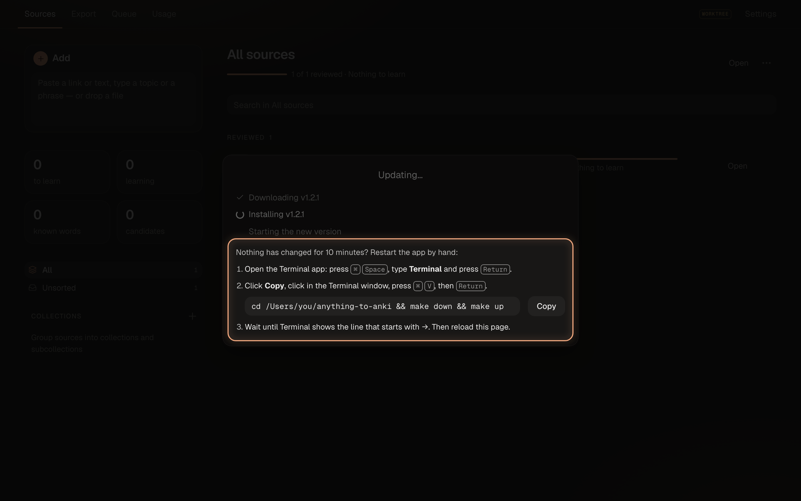
- A failed update stops at the step that broke and says which one, instead of trying to go back. The database is still backed up before the new version changes it.

## 1.2.0 — 2026-10-29

Arrange the Review card your way, and fill incomplete cards before export with one button.

### Card layout editor
**Settings → Card layout → Open the editor** opens the Review screen on a sample card, with the editor on top. Drag blocks between rows and columns, hide the ones you don't need, add dividers, and click a block to change its size, colour and place in its row. Switch what the sample card has to see how a card looks with or without a video, a picture or a meaning. Changes are saved at once, and **Reset to default** brings back the original layout. Anki cards are not affected.
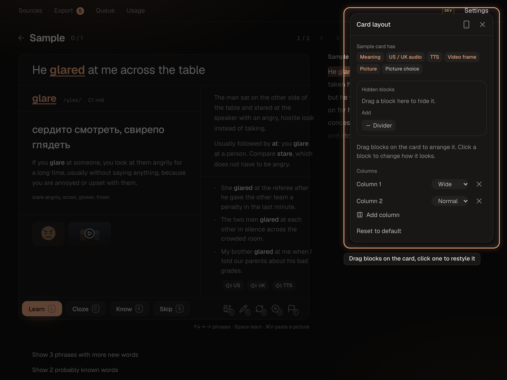

### Generate missing before export
On the export page, **Generate missing · N cards** fills in what incomplete cards lack, for every source on the page at once: the meaning and the audio of the phrase. Finished cards move to **Ready** on their own. A card it can't fill says why, for example when the video was never downloaded.
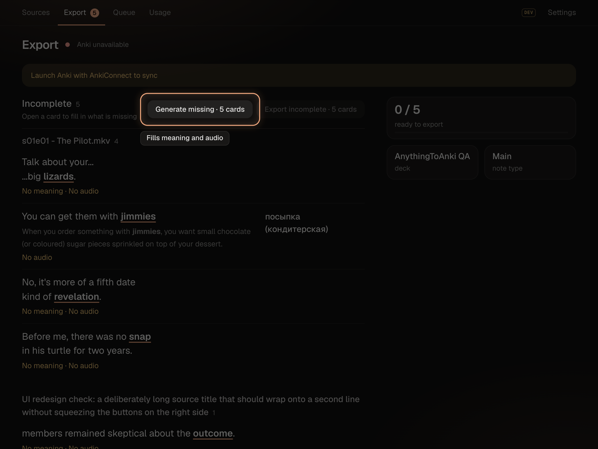

### Improvements
- The Review card has a new default layout. The left column holds the word with its transcription, level, frequency and usage, then the translation, definition, synonyms and the picture; the right column holds the context, examples and the audio buttons.
- A part with nothing to show is left out of the card, and an empty column gives its room to the others.

### No longer broken
- On a phone-wide window, Settings and **Update available** no longer slip off the header: a dot on the Settings gear shows that an update is out.

## 1.1.0 — 2026-10-28

The update screen now shows what is happening.

### Update stages
While the app updates, you see each stage: downloading the release, saving a backup, installing, starting the new version. Each stage is checked off as it ends, and you see them even while the app restarts.
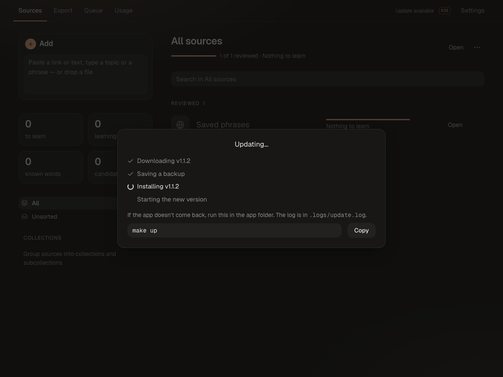

### No longer broken
- A card's usage label (formal, informal…) now matches the one that orders your cards.

## 1.0.1 — 2026-10-28

Small fixes after the first release.

### No longer broken
- **Check for Updates…** in the macOS app menu shows at once that it is checking, instead of a pause and then a sudden answer.
  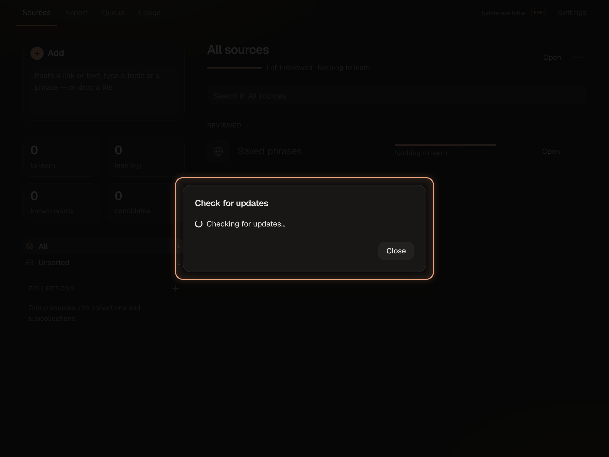
- Screenshots in the changelog and the guides now highlight things in the app's own style.

## 1.0.0 — 2026-10-28

The first release. From now on the app tells you when a new version is out and updates itself with one button.

### Updates from the app
When a new release is out, a quiet **Update available** appears in the header. Click it to read what's new, then press **Update**: the app installs the release, restarts and reloads the page. If anything goes wrong, it rolls back to the version you had, with your data as it was.


### New
- **Settings → Updates** shows your version, checks for updates on demand and opens the full changelog.
  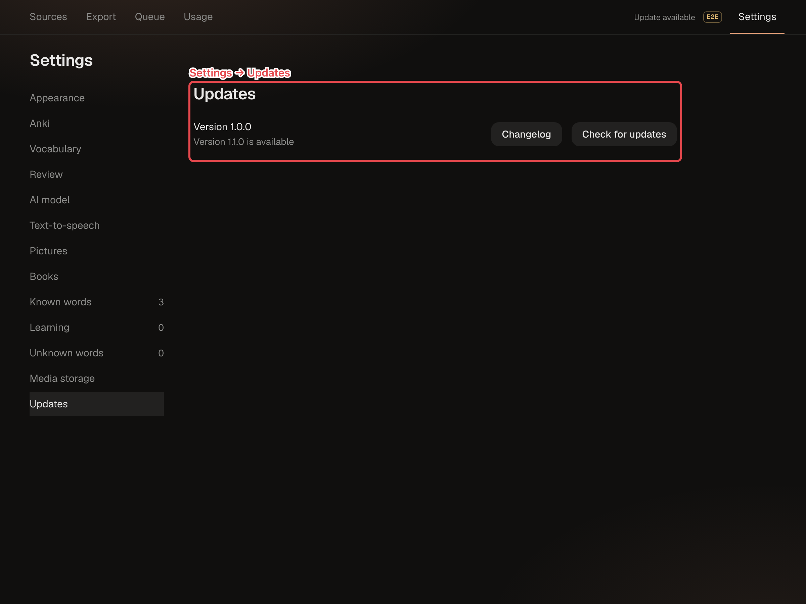
- **What's new** opens once after each update.
- In the macOS app, **Check for Updates…** in the app menu; after an update that changes the app itself, a **Restart** banner finishes it.
- `make update` updates from the terminal the same way.
