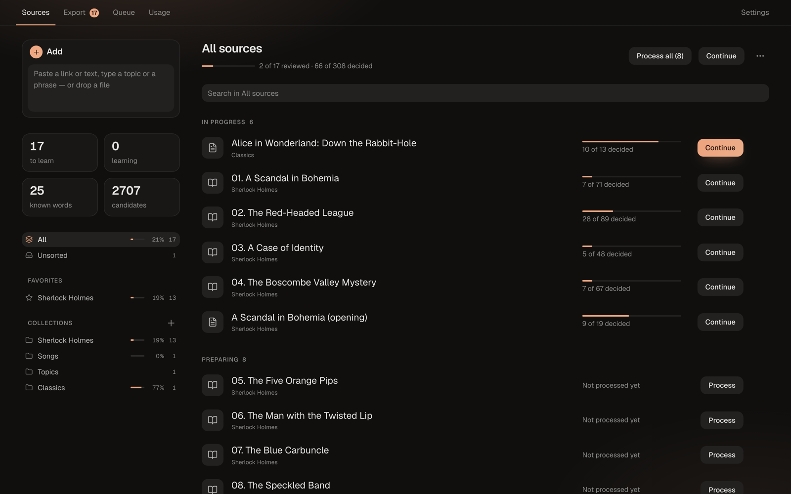
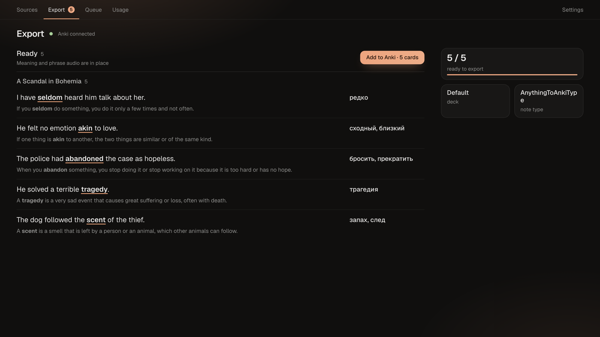

# AnythingToAnki

Learn English from what you already watch, listen to and read.

Give AnythingToAnki a film, a YouTube video, a song, an article or a book. It finds the words and phrasal verbs that are new to you, and makes a ready flashcard for each one. Every card is a phrase from that same source in which everything else is already familiar to you. You go through the cards, most useful first, and mark each one **Learn** or **Know**. **Learn** cards go to [Anki](https://apps.ankiweb.net/); **Know** words are never suggested again.

Everything runs locally on your Mac. AI features use your own [Claude Code](https://claude.com/claude-code) login, so no API key is needed.


## How it works

1. **Add a source.** Paste a text or a YouTube link, or drop a file: subtitles, a video, an EPUB book, Markdown or HTML.

   

2. **Process it.** The app splits the text into phrases and picks the targets that are new to you. It decides by your level, by the words you already know, and by how common each word is.
3. **Generate the cards.** AI writes a meaning, a translation, synonyms and examples, and can simplify hard sentences. Video sources get a screenshot and an audio clip of the phrase; other sources get the phrase read aloud.

   

4. **Review.** Decide card by card: **Learn**, **Cloze**, **Know** or **Skip**. The phrases where only the target is new come first. Hide the phrase list and the source text to see just the card.

   

5. **Export to Anki.** One click sends the cards, with their media, to Anki.

   

## Features

- **Many sources:** plain text, song lyrics, Markdown, HTML, `.srt` subtitles, video files (`.mp4`, `.mkv`, `.avi`, `.mov`), YouTube videos, and EPUB books split into chapters.
- **Topics:** ask for `phrasal verbs with get`; AI picks the words and the app finds real phrases for them in your sources.
- **Phrase-first cards:** each word is shown in a real sentence from your source, chosen so that the rest of it is familiar.
- **Words and phrasal verbs** are found automatically, including separated ones like `give … up`. Collocations such as `make a decision` can be added by hand or come from topics.
- **Your vocabulary:** a CEFR level, known words, and a quick calibration. Known words are skipped everywhere.
- **Rich cards:** meaning, translation, IPA, US and UK pronunciation, synonyms, examples, a picture, a video frame and clip, or text-to-speech.
- **Phrase polish:** AI rewrites long book sentences into short, simple ones, keeping the target.
- **Cloze cards** with hints.
- **Anki export** with automatic note types, or your own note type and field mapping.
- **Collections** to organise sources.
- **macOS app** with drag and drop, and **Quick Add** to save a phrase from any app.

## Requirements

- macOS with [Homebrew](https://brew.sh)
- [Claude Code](https://claude.com/claude-code), logged in
- [Anki](https://apps.ankiweb.net/) with the [AnkiConnect](https://ankiweb.net/shared/info/2055492159) add-on
- Dictionary data: see [Dictionaries](docs/reference/dictionaries.md)

## Quick start

```bash
git clone https://github.com/kudrmax/anything-to-anki.git
cd anything-to-anki
make setup
```

Set `DICTIONARIES_DIR` in `.env` to your dictionary folder (see [Installation](docs/getting-started/installation.md#3-dictionaries)), then:

```bash
make up
```

Open [http://localhost:17832](http://localhost:17832). Stop the app with `make down`.

The full guide: [Installation](docs/getting-started/installation.md), then [Your first source](docs/getting-started/first-source.md).

## Documentation

All documentation is in [docs/](docs/README.md):

- [Getting started](docs/README.md#getting-started)
- [User guide](docs/README.md#user-guide)
- [Reference](docs/README.md#reference)
- [Development](docs/README.md#development)

## License

[PolyForm Noncommercial 1.0.0](LICENSE.md). You may use, change and share the app for any noncommercial purpose. Commercial use is not allowed.
