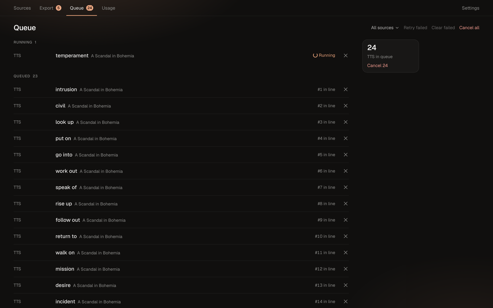
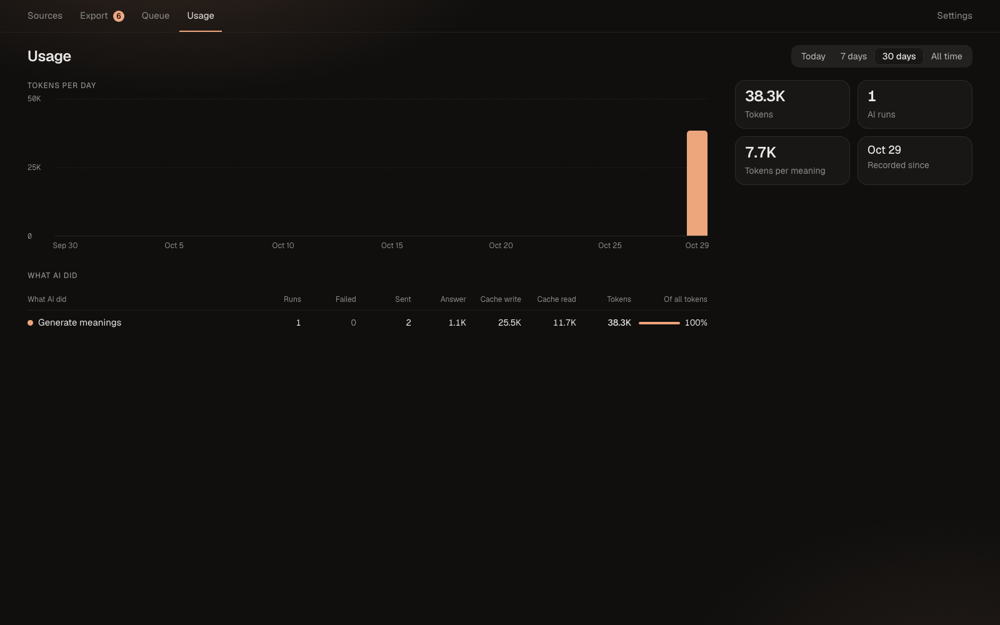

# Queue and AI usage

## Queue

Generation (meanings, polish, audio, screenshots, video downloads, topic words) runs in the background, one job per card. The **Queue** screen shows these jobs. The badge on **Queue** in the top bar counts jobs that are queued or running.

Jobs are grouped as **Running**, **Queued** and **Failed**.

- **Cancel** on a job removes it from the queue. A running job finishes, but its result is thrown away.
- Failed jobs are grouped by error. **Retry** puts them back in line, and **Clear** removes them from the list.
- **Retry failed**, **Clear failed** and **Cancel all** at the top apply to every job, or to one source if you pick it in the source filter.

| Job | What it does |
|---|---|
| **Video download** | Downloads a YouTube video so screenshots can be cut from it |
| **Topic targets** | AI proposes words for a [topic](sources.md#topics) |
| **Polish phrase** | AI simplifies a phrase |
| **Meaning** | AI writes the meaning, translation, synonyms, examples and IPA |
| **Meaning follow-up** | AI answers a follow-up question about a meaning |
| **Media** | Cuts a screenshot and an audio clip from a video |
| **Pronunciation** | Downloads the dictionary recording of a word |
| **TTS** | Reads a phrase aloud with a local voice |

AI jobs are sent in batches of 15 cards. A job that runs longer than 10 minutes fails with `timeout`.

### When AI is unavailable

If AI can't be reached, a banner appears at the top: **AI unavailable — reason**. AI jobs are not failed; they wait and resume on their own when AI is back. The app checks every 30 seconds. See [Troubleshooting](../reference/troubleshooting.md#ai-unavailable) for the reasons.

Jobs that were interrupted by a restart are put back in line when the app starts.

## Usage

AI runs through your Claude Code login, so it counts against your Claude plan's limits. The **Usage** screen shows how many tokens the app has used.

- **Period**: **Today**, **7 days**, **30 days** or **All time**.
- **Tokens**, **AI runs** and **Tokens per meaning**, with a comparison to the previous period.
- A chart of tokens per hour or day, split by feature.
- **What AI did**: a table by feature (**Generate meanings**, **Explain / give examples**, **Polish phrases**, **Topic: generate words**) with runs, failed runs and tokens.

The app shows tokens only, not money. To use less of your plan, choose a smaller model in [Settings → Cards → AI model](settings.md#cards).
