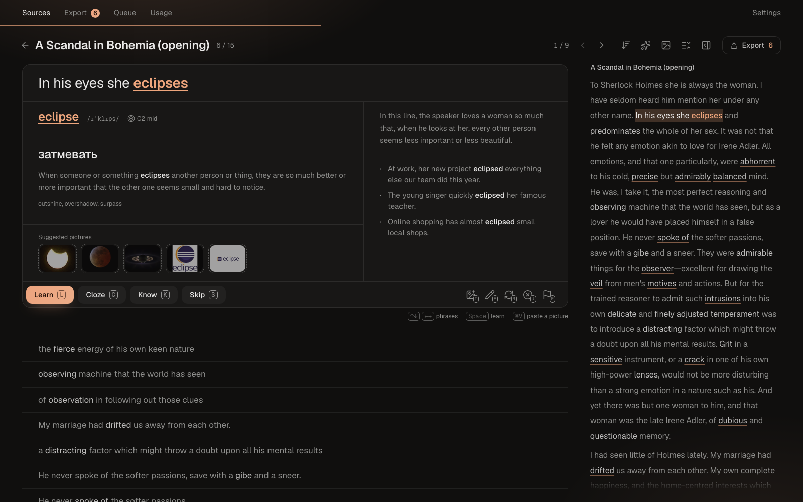
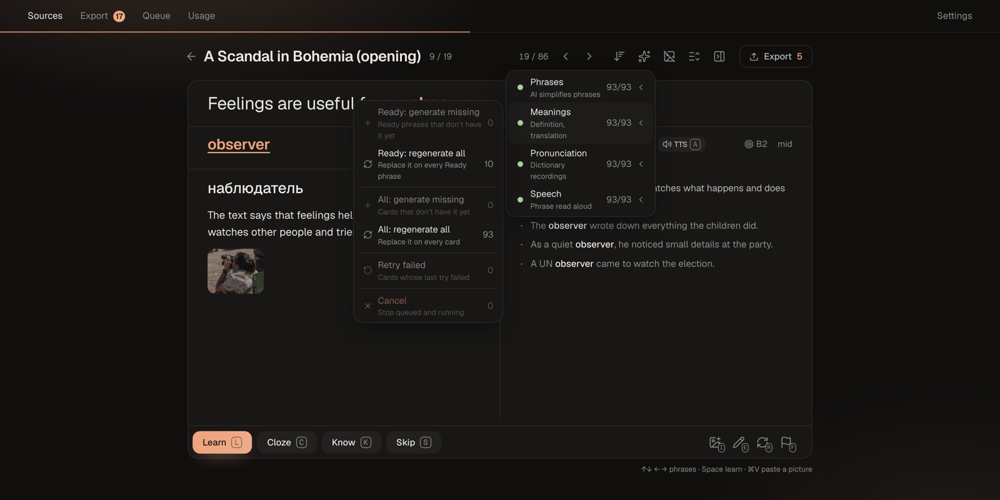
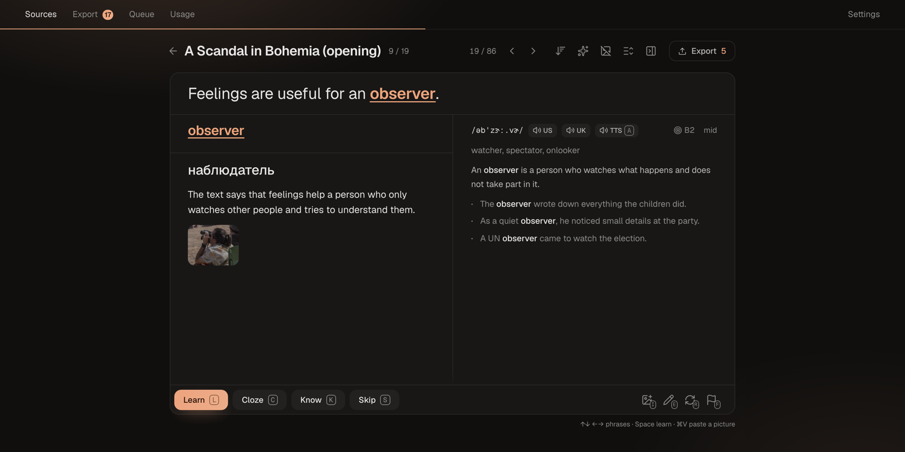

# Reviewing cards

The **Review** screen is where you decide, card by card, what to learn. Open it by clicking a processed source, or with **Review** / **Continue** on a source or collection. A review can cover one source, a collection with its subcollections, or all sources.

## What a card is

A card is a **phrase** from your source with one highlighted **target**. The target is the thing to learn: a word (`reluctant`), a phrasal verb (`give in`) or a collocation (`make a decision`). Processing finds words and phrasal verbs; collocations come from [topics](sources.md#topics) or from words you [select in the source text](#the-source-text).

The best cards are phrases where the target is the only new thing and everything else is familiar. The app puts those first.

### What is on a card

The phrase is at the top, with the target in bold. Below it, the left column holds what you decide by:

- **Lemma**: the dictionary form of the target, with its **IPA** transcription, its **CEFR level** (A1–C2) or **phrasal verb**, its **frequency** in English (ultra common, common, mid, low or rare) and its **usage**, such as formal or informal, next to it: the word's group that comes first in [Word usage priority](vocabulary.md#word-order-in-review), the one the word is sorted by; nothing is shown when that group is neutral. Hover the level to see how each dictionary rated it. 🎯 marks words in the "sweet spot": frequent enough to be useful, rare enough to be worth learning.
- **Translation**: a short translation of the target in this context. The translation is into **Russian**; to change the language, see [Configuration](../reference/configuration.md#translation-language).
- A **definition** and **synonyms**.
- **Picture** of the word, if you added one; otherwise **Suggested pictures · click to add** shows the first results of a picture search, and the Picture icon in the header turns them off. Next to it, the **video frame and clip** (video sources only): a screenshot and the audio of the phrase, cut from the video. ▶ plays it. They stand at the bottom of the column.

The right column holds the rest:

- **Context**: what is going on in the phrase, retold in simple English, and anything more the meaning adds.
- **Examples**. **Use as phrase** on an example makes it the card's phrase.
- **US / UK** buttons that play a dictionary recording of the word, and **TTS** that plays the phrase read aloud by a synthetic voice, at the bottom right.

This is the default layout. You can move, restyle and hide everything between the phrase and the bottom bar in the card layout editor: [Settings → Cards → Card layout](settings.md#card-layout).

The meaning, translation, synonyms, examples and IPA come from AI. Pronunciations and CEFR levels come from the [dictionaries](../reference/dictionaries.md). Everything else is computed locally.

## Deciding

Each card has four buttons:

| Button | Key | What it does |
|---|---|---|
| **Learn** | `L` or `Space` | You want to learn this word. It will go to Anki as a regular card |
| **Cloze** | `C` | You want to learn it as a fill-in-the-blank card. Opens the cloze editor (see below) |
| **Know** | `K` | You already know this word. It is added to your known words and never suggested again |
| **Skip** | `S` | Skips this phrase only. The word stays open, and its other phrases still show up |

**Learn**, **Cloze** and **Know** decide the **word**, not just the phrase: every card of that word, in every source, is done. On the word's other cards the buttons are disabled; change the decision on the card where you made it.

To take a decision off a card, press the same button again.

After every press, a toast such as **Know · give in** appears for 6 seconds. Click **Undo** in it, or press `⌘Z` (`Ctrl+Z`), to give the card back the mark it had before the press, and the screen returns to that card. Only the last press can be undone. Saving a new cloze counts as a press too.

Undo is a press in the other direction, not a rollback, so a few things do not come back:

- The link between a card and its Anki note, if the press took the card out of Anki. The next export finds the note and does not make a duplicate.
- What the press taught the app about word frequency, and an **Unknown** mark you set on that word in a report.

After a press, the screen moves to the next open card right away, and the decided card moves to the **Reviewed** section.

Your **Learn** and **Know** presses also tune the app: they teach it how frequent a word must be for you to probably know it already.

### Sections

Cards are split into sections:

| Section | What is in it |
|---|---|
| **Ready** | Phrases where only the target is new to you. Start here |
| **Extra** | Phrases with more than one new word. Folded by default |
| **Probably known** | Words common enough that you most likely know them. Folded by default |
| **Reviewed** | Cards you have decided or skipped. Folded by default |

Click the fold row (for example **Show 12 probably known words**) to open a section.

### Sorting

The sort menu in the header offers:

- **Relevance** (default): the most useful words first. The app ranks fewer other new words, frequency, usage, CEFR level and how often the word occurs.
- **Key words**: words that occur most often in this text come first. Useful before reading a text.
- **Text order**: cards in the order they appear in the source, without sections.

The cards of one word always stand together.

## Generating card content

Processing makes the phrases, but not their meanings or audio. The **✨** menu in the header generates them for the whole set:

| Item | What it makes | Needs |
|---|---|---|
| **Phrases** | AI rewrites hard phrases into simple ones (see [Polish](#polish)) | AI; not for video sources |
| **Meanings** | Definition, translation, synonyms, examples, IPA | AI |
| **Media** | Screenshot and audio clip of the phrase | Video sources; YouTube videos are downloaded first |
| **Pronunciation** | US and UK recordings of the word | Dictionary audio |
| **Speech** | The phrase read aloud by a local TTS voice | Not for video sources: they have their own audio |

Each item has a submenu:

- **Ready: generate missing** and **Ready: regenerate all** cover the cards in the Ready section.
- **All: generate missing** and **All: regenerate all** cover every open card.
- **Retry failed** and **Cancel**.
- For YouTube sources, **Download video** downloads the video before media can be cut from it.

Generation runs in the background, and you can keep reviewing meanwhile. Cards fill in as results arrive. Progress and failures are on the [Queue](queue-and-usage.md#queue) screen.

A typical flow: process a source, then run **Meanings → Ready: generate missing** (and **Phrases** for books and articles), then review.

## Card tools

The buttons in the card's footer:

| Tool | Key | What it does |
|---|---|---|
| Picture | `I` | Search Wiktionary, Bing and Yandex for a picture of the word. You can also paste an image with `⌘V` anywhere on the screen |
| Edit | `E` | **Edit text** fixes words in the phrase. **Change boundary** re-cuts the phrase from the source text. **Target only** replaces the phrase with the bare word |
| Regenerate | `R` | Regenerates the meaning, or asks AI a follow-up: **Give examples**, **Explain in detail**, **Explain simpler**, **How to say it**, or **Your own question**. Also **Polish**, **Speech**, and **Screenshot and clip** for video |
| Unknown words | `U` | Marks words of the phrase you don't know (see below) |
| Report | `F` | Reports a problem with the card (see below) |

Double-clicking the phrase also edits it.

### Polish

Book and article sentences are often long and hard to understand without context. **Polish** asks AI to rewrite the phrase into a short, simple one (about 5–12 words) that reads easily at your level. The target stays in exactly the same form and meaning. An easy phrase comes back unchanged.

- Run it for all cards with **✨ → Phrases**, or for one card with **Regenerate → Polish**.
- On a polished card, **Regenerate → Polish** opens a comparison with the original. It offers **Revert to original**, **Use polished phrase** and **Polish again**.
- A polished phrase gets a new meaning and new speech, because the old ones described the old phrase.
- Phrases of video sources are never polished, because the audio clip must match the phrase. Saved phrases are never polished either.

### Unknown words

**Unknown words** (`U`) shows the phrase with every word clickable. Click the words you don't know and press **Mark as unknown**. They go to your **Unknown words**, and phrases with them no longer count as Ready.

### Report

**Report** stores a problem with a card together with a snapshot of the card. Pick one or more reasons, or describe the problem in your own words.

## Cloze cards

A cloze card hides words of the phrase, and you recall them: `She was [...] to leave.`

1. Press **Cloze** (`C`). The target words are hidden by default.
2. Click words to hide or show them.
3. Choose a **Hint**: **No hint**, **Translation**, **Synonyms**, **First letter**, or **Custom**. The default comes from [Settings → Cards → Default cloze hint](settings.md#cards).
4. Check the **Anki front** preview, then press **Save cloze** (`Enter`).

To change the hidden words later, click the phrase. You can do this until the card is exported to Anki.

## The source text

The panel on the right shows the source text, with every target marked. The current card's phrase is shaded.

- Click a marked word to jump to its card.
- **Select text** to add a word the app missed. Tap the words that make up the target, then press **Add word**. The selection becomes the card's phrase.
- **Edit → Change boundary** uses the same panel: select the new phrase, then press **Set boundary**.

## Layout

The icons in the header, left of **Export**, change what the screen shows:

| Icon | What it does |
|---|---|
| Sort | Opens the [sort menu](#sorting) |
| ✨ | Opens the [Generate menu](#generating-card-content) |
| Picture | Shows or hides **Suggested pictures** on cards |
| List | Shows or hides the phrase list under the card |
| Panel | Shows or hides the source text on the right |

With the phrase list and the source text hidden, only the current card is left. Move between cards with the arrows. The app remembers the layout.

## Keyboard shortcuts

Keys work in any keyboard layout. They are ignored while you type in a field or while a menu is open.

| Key | Action |
|---|---|
| `↑` `←` / `↓` `→` | Previous / next card |
| `L` or `Space` | Learn |
| `C` | Cloze |
| `K` | Know |
| `S` | Skip |
| `A` | Play or stop the card's audio |
| `I` | Picture |
| `E` | Edit menu |
| `R` | Regenerate menu |
| `U` | Unknown words |
| `F` | Report menu |
| `⌘V` | Paste a picture onto the card |
| `⌘Z` | Undo the last press, while its toast is shown |
| `Esc` | Cancel editing, cloze or boundary change |
| `Enter` | Save the cloze or the edited text |

On a phone, swipe left or right on the card to move between cards.

**Auto-play audio** plays the card's audio when it opens: the video clip, else the TTS, else the US pronunciation. Turn it off in [Settings → Cards → Auto-play audio](settings.md#cards).

## When you are done

The header shows how many cards you have reviewed. **Export N** opens [export to Anki](anki-export.md) for this set.
