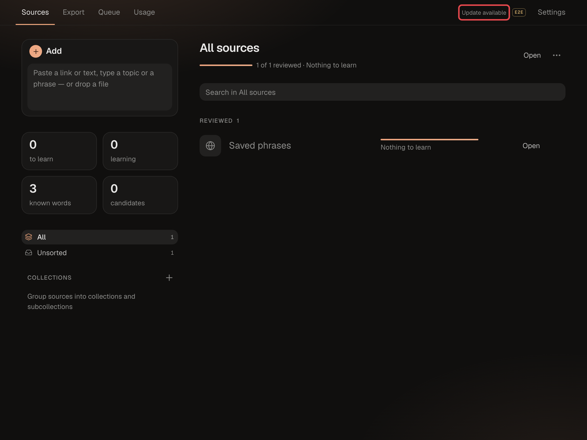
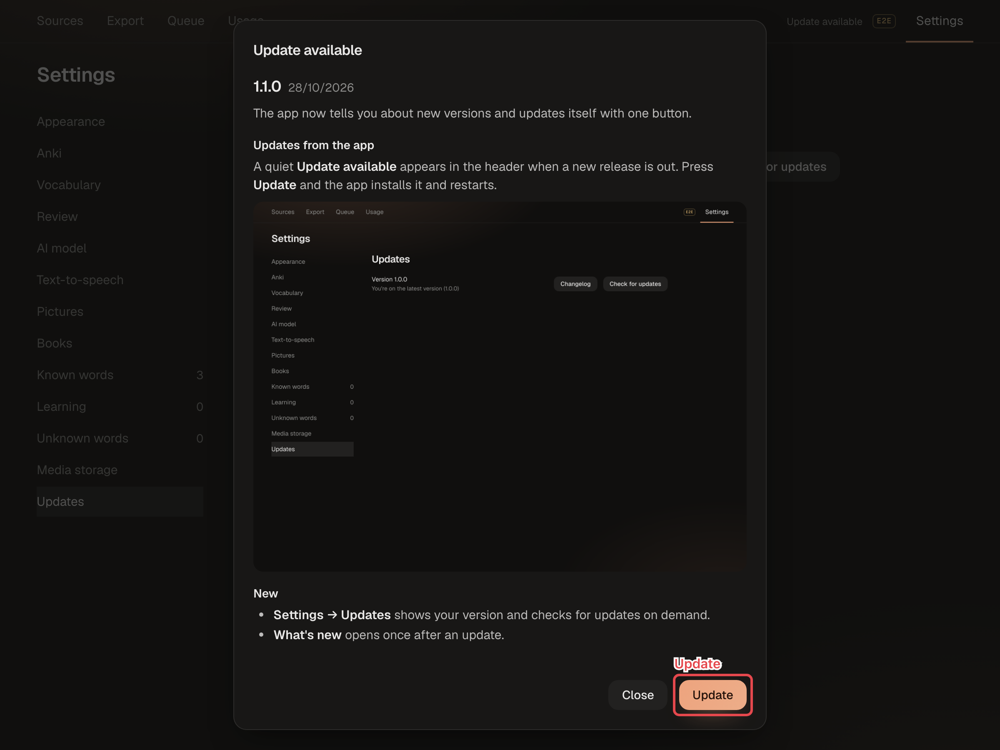

# Updating

AnythingToAnki is released in versions. The app checks for a new one and updates itself with one button.

## Finding out about a new version

Once a day the app looks for a release newer than the one you run. If it finds one, a quiet **Update available** appears in the header. It stays until you update. On a phone-wide window the header has no room for it: a dot on the Settings gear shows instead, and **Settings → Updates** says which version is out.



To look right now, open **Settings → Updates** and press **Check for updates**, or choose **Check for Updates…** in the macOS app's menu. If nothing is new, you see "You're on the latest version".


## Updating

1. Click **Update available**. The window lists every version newer than yours, with what changed.
2. Press **Update**.
3. **Updating…** covers the app while it installs the release and restarts. Don't close the app. A page opened or reloaded while the update runs shows **Updating…** too.

   Under it is the list of stages. Finished ones have a check mark, the one running now has a spinner:

   - **Downloading v1.2.0** (it says **Checking for the new version** until the version is known)
   - **Installing v1.2.0**: the app stops and switches to the release, and the macOS app is rebuilt when it changed
   - **Starting the new version**: the Python and frontend packages the release needs are installed, then the app starts and migrates the database

   If a stage fails, it is marked with a cross and the stages after it are dropped.
4. The page reloads and shows **What's new**. Close it and it won't appear again.



While a long operation runs, such as a big import, pressing **Update** shows the long-operation window instead of updating. Wait for it to finish and press **Update** again.

## What's new and the changelog

**What's new** shows once after an update, with every version since the last one you saw. On a fresh install it doesn't appear.

**Settings → Updates → Changelog** opens the whole history at any time. The same text is in `CHANGELOG.md` and on the project's GitHub Releases page.

## If the update hangs

**Updating…** always says what to do if nothing changes for 10 minutes: restart the app by hand. You don't need to know the terminal for it:

1. Open the Terminal app: press ⌘ Space, type **Terminal** and press Return.
2. In the update window, click **Copy** next to the command. Click in the Terminal window, press ⌘ V, then Return. The command goes to the app's folder, stops the app and starts it again.
3. Wait until Terminal shows the line that starts with →, then reload the page.

The command is the app's own folder followed by `make down && make up`, for example:

```bash
cd ~/anything-to-anki && make down && make up
```

If Terminal shows an error instead, the full log of the update is in `.logs/update.log` in the app's folder, and `make logs` shows it too.

While the app is stopped, `make update` answers the page on the app's port with a small status server of its own, so the list keeps moving. It stops just before the app starts again; if it can't start, for example because the port is taken, the update goes on and the list stays on the last stage it showed.

## If the update fails

The window says **Update failed**. It shows what failed and the end of the update's log, then the same three steps as above with the command that runs the update by hand, `cd <the app's folder> && make update`. Terminal then shows every step of the update and the error. The full log is in `.logs/update.log`, and `make logs` shows it too.

The update does not go back to the previous version. It stops at the step that failed, the way it would if you typed the commands yourself. The database is copied to `data/backups/` before the new version migrates it.

## From the terminal

```bash
make update
```

`make update` does what the button does, and what you would type by hand:

1. Refuses if you changed tracked files in the project folder. Commit or undo your changes first. It also refuses in a git worktree: run it in the main checkout. And it refuses while another update runs in the same folder.
2. Fetches the releases (`git fetch --tags`). If you already have the latest one, it prints "Already up to date" and changes nothing. This is also the case when you run the development version from `master`, which is never older than the last release.
3. Stops the app (`make down`) and switches to the latest release (`git checkout <tag>`).
4. Rebuilds the macOS app if you built it and it changed.
5. Starts the app (`make up`). `make up` installs the Python and frontend packages when the release changed them, and the database is migrated on start.

## macOS app

When the update changes the app itself, a note in its title bar says **Restart to finish the update** with a **Restart** button. See [The macOS app](macos-app.md#updates).
