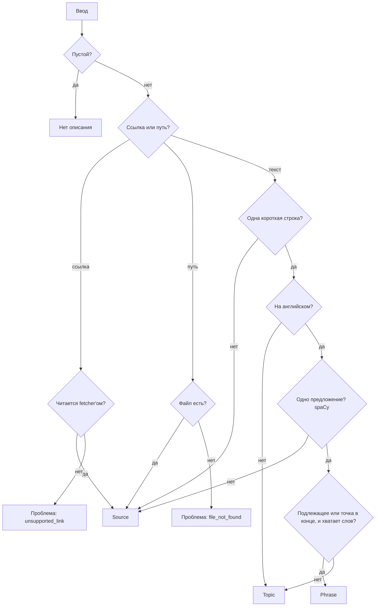

# Экран Add: режим по вводу и честные ошибки

Экран Add принимает в одно поле всё подряд: текст, путь к файлу, ссылку, тему, фразу. Сейчас он не помогает понять, во что превратится ввод, и разрешает добавить заведомо неправильное. Спека закрывает три проблемы, найденные при разборе экрана:

1. **Режим не угадывается.** По умолчанию всегда Source: одно слово или одно предложение превращается в источник.
2. **Выбранный руками режим залипает.** Выбрал Topic, потом вставил ссылку на YouTube — кнопка всё равно «Add topic».
3. **Ошибка видна, но кнопка активна.** Неподдерживаемая ссылка помечена мелким серым текстом, «Add source» при этом нажимается. Для несуществующего файла экран пишет «Book · epub», а ошибка появляется только после нажатия.

Остальные находки разбора (фразу видно дважды, порядок полей, что делать после добавления) сюда не входят.

---

## Термины

- **Ввод** — то, что пользователь вставил или набрал в поле экрана Add.
- **Вид ввода** (`InputKind`) — во что ввод превратится после нажатия кнопки:
  - **Source** — источник: текст, файл, ссылка. Из него извлекаются фразы и target'ы.
  - **Topic** — тема: область словаря («medicine»), ситуация («returning an item to a shop»), группа слов («phrasal verbs with get») или одно слово. Target'ы для неё придумывает AI, фразы ищутся в других источниках.
  - **Phrase** — сохранённая фраза: одно предложение, в котором пользователь отмечает target.
- **Предложенный вид** — вид ввода, который backend считает подходящим.
- **Выбранный вид** — вид ввода, который пользователь переключил руками. Отсутствует, пока пользователь ничего не переключал.
- **Проблема ввода** (`InputProblem`) — причина, по которой ввод заведомо не добавится:
  - `unsupported_link` — ссылка, которую приложение не умеет читать (сейчас читается только YouTube);
  - `file_not_found` — по пути нет файла (нет ничего или там папка).

---

## Поведение экрана

| Ввод | Предложенный вид | Что видно | Кнопка |
|---|---|---|---|
| Одно предложение: «She shrugged off the comment and kept walking.» | Phrase | Слова для выбора target'а | «Add phrase» |
| Короткий запрос или одно слово: «medicine», «make a decision», «procrastinate» | Topic | «Topic — AI picks targets, phrases come from your sources» | «Add topic» |
| Любая строка не на английском: «медицина», «как пожаловаться начальнику» | Topic | То же | «Add topic» |
| Несколько строк или предложений, текст песни, файл, ссылка на YouTube | Source | Как прочитается ввод: «Text», «Book · epub», «Video · YouTube» | «Add source» |
| Ссылка не на YouTube | — | Ошибка и что сделать вместо этого | Выключена |
| Путь, по которому нет файла | — | Ошибка и что сделать вместо этого | Выключена |

Правила:

- **Режим по умолчанию — предложенный вид.** Пользователь может переключить его руками.
- **Ручной выбор держится, пока пользователь набирает текст,** и сбрасывается, когда ввод заменён целиком: вставка из буфера, перетаскивание файла, выбор файла кнопкой «Choose…», очистка поля. Так набор фразы по буквам не сбрасывает выбор на каждом слове («She» → Topic, «She shrugged off» → Phrase), а вставленная ссылка — сбрасывает.
- **Пока backend описывает новый ввод, экран показывает прежнее описание.** Режим, кнопка и подпись не исчезают и не мигают; рядом с подписью крутится индикатор.
- **Проблема ввода блокирует кнопку.** Под полем — что не так и что сделать вместо этого, поле подсвечено. Переключатель режима, поле Title и поле для `.srt` при проблеме не показываются: ни один режим такой ввод не примет.
- **«Как прочитается ввод»** (`Text`, `Book · epub`, `Video · YouTube`) показывается рядом с переключателем режима, обычным размером, а не мелким текстом у правого края.
- **Поле Title** — как сейчас: для Source и Topic есть, для Phrase нет. **Поле `.srt`** — как сейчас: только когда ввод прочитается как видеофайл.

Макет: `design-previews/add-screen-intake.html` (пять кадров: слово, предложение, смена ввода, неподдерживаемая ссылка, нет файла). Тексты подсказок в макете — новые, ими заменяются нынешние `TOPIC_HINT` и `PHRASE_HINT`.

---

## Как backend предлагает вид ввода

Решение принимает backend: другой фронтенд (бот, CLI) должен получить тот же ответ и те же тексты.

Порядок проверки — сначала дешёвые правила, spaCy только для одной короткой строки:

1. **Пустой ввод** (одни пробелы) → описания нет: `kind`, `problem` и `label` пустые.
2. **Ссылка или путь к файлу** (как сейчас в `typed_input`) → Source.
   - Ссылка, которую не читает ни один fetcher, → проблема `unsupported_link`.
   - Путь, по которому после `normalize_typed_path` нет файла (`FileReader.exists`), → проблема `file_not_found`.
3. **Больше одной строки** → Source. Фраза из субтитров или книги, скопированная с переносом, тоже станет Source — её можно переключить на Phrase руками.
4. **Строка длиннее `MAX_PHRASE_CHARS`** → Source, без разбора spaCy. Так вставленная одной строкой книга не уходит в парсер на каждое нажатие клавиши.
5. **Строка не на английском** → Topic, без разбора spaCy. Фраза для карточки всегда английская — она взята из английского контента. А тему пользователь вбивает на любом языке: AI понимает запрос «медицина» так же, как «medicine». Признак — в строке есть буквы не латиницей (`InputLanguage`, см. ниже).
6. **Одна короткая английская строка** разбирается `TextAnalyzer` (spaCy):
   - больше одного предложения (`TokenData.sent_index`) → Source;
   - **одно предложение** → `InputKindClassifier` отвечает Phrase или Topic.

**Phrase или Topic.** Тема — это запрос, а не высказывание: в нём нет подлежащего и нет точки в конце. Повелительные запросы-темы («make a decision», «deal with a difficult boss», «how to complain») должны оставаться темами.

- **Phrase** — предложение не короче `MIN_PHRASE_WORDS` слов, в котором есть подлежащее при глаголе в личной форме (`nsubj`), **или** которое заканчивается знаком конца предложения (`.`, `!`, `?`). Так «Get out of here!» — фраза, а «get out of» — тема.
- **Topic** — всё остальное: одно слово, словосочетание, запрос без подлежащего и без точки.

Пороги (`MAX_PHRASE_CHARS`, `MIN_PHRASE_WORDS`) и знаки конца предложения — именованные константы в одном месте.

**Что не распознаётся** (как и сейчас; вне этой спеки): путь Windows (`C:\…`) и относительный путь (`book.epub`), ссылка внутри текста («watch this https://youtu.be/…»), запрос на другом языке латиницей («medicina»). Такой ввод получает предложение по правилам для текста, и пользователь может переключить режим руками.

---

## Изменения в коде

### Domain

- **`InputKind`** — новый enum в `domain/value_objects`: `SOURCE`, `TOPIC`, `PHRASE`.
- **`InputProblem`** — новый enum там же: `UNSUPPORTED_LINK`, `FILE_NOT_FOUND`.
- **`InputKindClassifier`** — новый доменный сервис в `domain/services`. Получает токены одного английского предложения (`list[TokenData]`) и отвечает `PHRASE` или `TOPIC` по правилу выше. Не знает про spaCy и про Source: правила 1–5 и подсчёт предложений — в use case.
- **`InputLanguage`** — функция в `domain/services`: написана ли строка по-английски. Признак — все буквы латинские; набор алфавита — именованная константа.

### Application

- **`DetectFormatUseCase` → `DescribeInputUseCase`.** Тот же use case, расширенный: кроме формата он отвечает, во что превратится ввод. Зависимости: `FormatDetector` (как сейчас), `FileReader` (проверка файла), `TextAnalyzer` (предложения), `InputKindClassifier`. Все создаются в `infrastructure/container.py`.
- **`DetectedFormatDTO` → `InputDescriptionDTO`:**
  - `kind: InputKind | None` — предложенный вид; пусто при проблеме и для пустого ввода;
  - `format: Format | None` — как сейчас, только для Source;
  - `label: str | None` — «как прочитается ввод», только для Source;
  - `problem: InputProblem | None`;
  - `problem_message: str | None` — что не так («This link can't be read», «No file at this path»);
  - `problem_hint: str | None` — что сделать вместо этого.
- Константа `UNSUPPORTED_LINK_LABEL` уходит: неподдерживаемая ссылка теперь проблема, а не подпись.

### API

- **`POST /sources/detect-format` → `POST /sources/describe-input`**, отдаёт `InputDescriptionDTO`. Маршрут вызывает только экран Add, поэтому переименовывается вслед за use case; интеграционный тест `test_detect_format_and_topic.py` — тоже.

### Frontend (`screens/sources/AddSourceForm.tsx`)

- Тип `DetectedFormat` → `InputDescription`, `api.detectFormat` → `api.describeInput`.
- Описание ввода запрашивается **в любом режиме**, а не только в Source (сейчас `mode === 'source'`).
- Хранит **выбранный вид** (`Mode | null`) вместо режима по умолчанию `'source'`. Показанный режим — выбранный вид, если он есть, иначе предложенный.
- Выбранный вид сбрасывается в `null` при вставке (`onPaste`), перетаскивании, выборе файла и в `reset`. Нынешние вызовы `setMode('source')` в `reset`, обработчике перетаскивания и `pickFile` превращаются в этот сброс: предложенный вид для файла и так Source.
- Пока запрос в полёте, держит прежнее описание; индикатор — рядом с подписью.
- При `problem`: `problem_message` и `problem_hint` под полем, поле подсвечено, кнопка выключена; переключатель режима, Title и поле `.srt` скрыты.
- Подпись `label` — рядом с переключателем, обычным размером.

Фронт не решает сам, что такое предложение, тема или ссылка, и не хранит тексты ошибок: всё приходит в `InputDescriptionDTO`.

---

## Тесты

- **`InputKindClassifier`:** одно слово; словосочетание («phrasal verbs with get»); герундий («returning an item to a shop»); повелительный запрос без точки («make a decision», «deal with a difficult boss») → Topic; повелительное предложение с точкой или восклицательным знаком («Get out of here!») → Phrase; предложение с подлежащим без точки → Phrase; предложение короче `MIN_PHRASE_WORDS`.
- **`InputLanguage`:** английская строка; кириллица; смесь кириллицы и латиницы («тема: phrasal verbs») → не английский; цифры и знаки без букв.
- **`DescribeInputUseCase`:** пустой ввод; строка по-русски — слово, запрос, предложение с точкой → Topic, spaCy не вызывается; ссылка на YouTube; ссылка не на YouTube; существующий файл, несуществующий файл, папка вместо файла, путь в кавычках; многострочный текст; текст песни; строка длиннее `MAX_PHRASE_CHARS` (spaCy не вызывается); две фразы в одной строке; одно предложение; короткий запрос.
- **`AddSourceForm`:** режим по умолчанию — предложенный; ручной выбор держится при наборе и сбрасывается при вставке, перетаскивании, выборе файла; пока запрос в полёте, показано прежнее описание; при `problem` кнопка выключена, видны оба текста ошибки, нет переключателя, Title и поля `.srt`.

---

## Открытые вопросы

1. **`MIN_PHRASE_WORDS`.** Предложение из двух слов с точкой («Get out.») — фраза или тема? Предлагаю порог 3 и поправить по практике.
