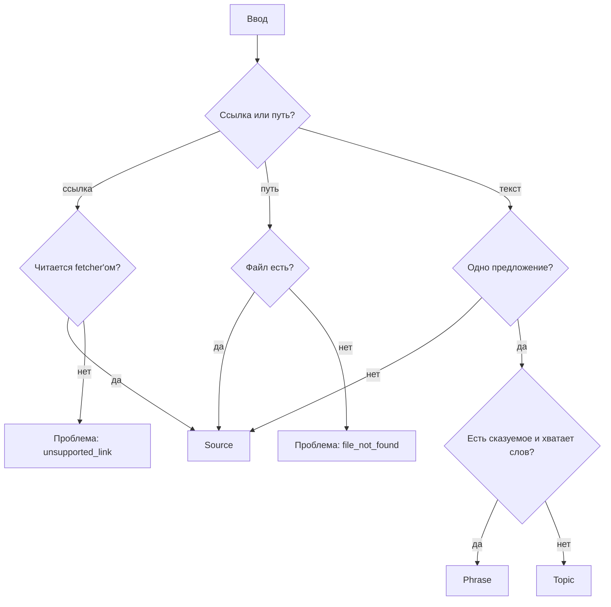

# Экран Add: режим по вводу и честные ошибки

Экран Add принимает в одно поле всё подряд: текст, путь к файлу, ссылку, тему, фразу. Сейчас он не помогает понять, во что превратится ввод, и разрешает добавить заведомо неправильное. Спека закрывает три проблемы, найденные при разборе экрана:

1. **Режим не угадывается.** По умолчанию всегда Source: одно слово или одно предложение превращается в источник.
2. **Выбранный руками режим залипает.** Выбрал Topic, потом вставил ссылку на YouTube — кнопка всё равно «Add topic».
3. **Ошибка видна, но кнопка активна.** Неподдерживаемая ссылка помечена мелким серым текстом, «Add source» при этом нажимается. Для несуществующего файла экран пишет «Book · epub», а ошибка появляется только после нажатия.

Остальные находки разбора (фразу видно дважды, порядок полей, что делать после добавления) сюда не входят.

---

## Термины

- **Ввод** — то, что пользователь вставил или набрал в поле экрана Add.
- **Вид ввода** (`InputKind`) — во что ввод превратится после нажатия кнопки:
  - **Source** — источник: текст, файл, ссылка. Из него извлекаются фразы и target'ы.
  - **Topic** — тема: область словаря («medicine»), ситуация («returning an item to a shop») или группа слов («phrasal verbs with get»). Target'ы для неё придумывает AI, фразы ищутся в других источниках.
  - **Phrase** — сохранённая фраза: одно предложение, в котором пользователь отмечает target.
- **Предложенный вид** — вид ввода, который backend считает подходящим для этого ввода.
- **Выбранный вид** — вид ввода, который пользователь переключил руками. Отсутствует, пока пользователь ничего не переключал.
- **Проблема ввода** (`InputProblem`) — причина, по которой ввод заведомо не добавится. Бывают две:
  - `unsupported_link` — ссылка, которую приложение не умеет читать (сейчас читается только YouTube);
  - `file_not_found` — путь к файлу, которого нет.

---

## Поведение экрана

| Ввод | Предложенный вид | Что видно | Кнопка |
|---|---|---|---|
| Одно предложение, например «She shrugged off the comment and kept walking.» | Phrase | Слова для выбора target'а | «Add phrase» |
| Короткий запрос без предложения: «medicine», «phrasal verbs with get» | Topic | «Topic — AI picks targets, phrases come from your sources» | «Add topic» |
| Несколько предложений, текст песни, файл, ссылка на YouTube | Source | Как прочитается ввод: «Text», «Book · epub», «Video · YouTube» | «Add source» |
| Ссылка не на YouTube | — | Ошибка «This link can't be read» и что сделать вместо этого | Выключена |
| Путь к несуществующему файлу | — | Ошибка «File not found» | Выключена |

Правила:

- **Режим по умолчанию — предложенный вид.** Пользователь может переключить его руками, и выбранный вид действует, пока предложение для ввода не изменилось.
- **Изменился предложенный вид — выбор пользователя сбрасывается.** Ввод стал другим по сути (было предложение — стала ссылка), значит, прежний выбор к нему не относится.
- **Проблема ввода блокирует кнопку.** Ошибка показывается под полем: что не так и что сделать вместо этого. Переключатель режима при проблеме не показывается: ни один режим такой ввод не примет.
- **«Как прочитается ввод»** (`Text`, `Book · epub`, `Video · YouTube`) показывается рядом с переключателем режима, обычным размером, а не мелким текстом у правого края.

Макет: `design-previews/add-screen-intake.html` (пять кадров: слово, предложение, смена ввода, неподдерживаемая ссылка, нет файла).

---

## Как backend предлагает вид ввода

Решение принимает backend: это бизнес-правило, другой фронтенд (бот, CLI) должен получить тот же ответ.

Порядок проверки:

1. **Ссылка или путь к файлу** (как сейчас в `typed_input`) → Source. Для ссылки, которую не читает ни один fetcher, — проблема `unsupported_link`. Для пути, по которому нет файла (`FileReader.exists`), — проблема `file_not_found`.
2. **Многострочный текст или несколько предложений** → Source. Предложения считает `TextAnalyzer` (spaCy, `TokenData.sent_index`).
3. **Одно предложение со сказуемым** → Phrase. Сказуемое — корень предложения (`dep == "ROOT"`) это глагол в личной форме или в повелительном наклонении. Плюс минимальная длина фразы в словах — именованная константа.
4. **Всё остальное** (короткий запрос без сказуемого) → Topic.

Пороги и списки тегов — именованные константы в одном месте, без магических чисел.

---

## Изменения в коде

### Domain

- **`InputKind`** — новый enum в `domain/value_objects`: `SOURCE`, `TOPIC`, `PHRASE`.
- **`InputProblem`** — новый enum там же: `UNSUPPORTED_LINK`, `FILE_NOT_FOUND`.
- **`InputKindClassifier`** — новый доменный сервис в `domain/services`. Получает токены одной строки текста (`list[TokenData]`) и отвечает Phrase или Topic по правилам 2–4. Не знает про spaCy: работает на `TokenData`.

### Application

- **`DetectFormatUseCase` → `DescribeInputUseCase`.** Тот же use case, расширенный: кроме формата он отвечает на «во что превратится ввод». Зависимости: `FormatDetector` (как сейчас), `FileReader` (проверка файла), `TextAnalyzer` (предложения), `InputKindClassifier`.
- **`DetectedFormatDTO` → `InputDescriptionDTO`:**
  - `kind: InputKind | None` — предложенный вид; `None`, если есть проблема;
  - `format: Format | None` и `label: str` — как сейчас, только для Source;
  - `problem: InputProblem | None`;
  - `problem_hint: str | None` — что сделать вместо этого, текстом для пользователя.

### API

- **`POST /sources/detect-format`** отдаёт `InputDescriptionDTO`. Путь остаётся прежним: его вызывает только экран Add.

### Frontend (`screens/sources/AddSourceForm.tsx`)

- Хранит **выбранный вид** (`Mode | null`) вместо режима по умолчанию `'source'`. Показанный режим — выбранный вид, если он есть, иначе предложенный.
- Когда пришло новое описание ввода с другим `kind` — выбранный вид сбрасывается в `null`.
- При `problem` — ошибка под полем (`problem_hint` второй строкой), поле подсвечено, кнопка выключена, переключатель режима скрыт.
- Подпись `label` — рядом с переключателем, обычным размером.
- Пока описание ввода не пришло (debounce 300 мс), режим и кнопка не показываются — как сейчас.

Фронт не решает сам, что такое предложение, тема или ссылка: всё это приходит в `InputDescriptionDTO`.

---

## Тесты

- `InputKindClassifier`: одно слово, короткий запрос, запрос с герундием («returning an item to a shop»), одно предложение, повелительное предложение, предложение короче минимальной длины.
- `DescribeInputUseCase`: ссылка на YouTube, ссылка не на YouTube, существующий и несуществующий файл, многострочный текст, текст песни, одно предложение, короткий запрос.
- `AddSourceForm`: режим по умолчанию — предложенный; ручной выбор держится, пока `kind` не изменился; сбрасывается при смене `kind`; при `problem` кнопка выключена и видна ошибка.

---

## Открытые вопросы

1. **Во что превращается одно английское слово**, например «procrastinate»? По правилам выше это Topic, и AI подберёт лексику вокруг прокрастинации. Если пользователь хочет выучить само слово, нужен другой путь (например, сохранить его как фразу из примера), и этой спеки он не касается.
2. **Минимальная длина фразы.** Предложение из двух слов («Get out.») — это фраза или тема? Предлагаю начать с порога в 3 слова и поправить по практике.
